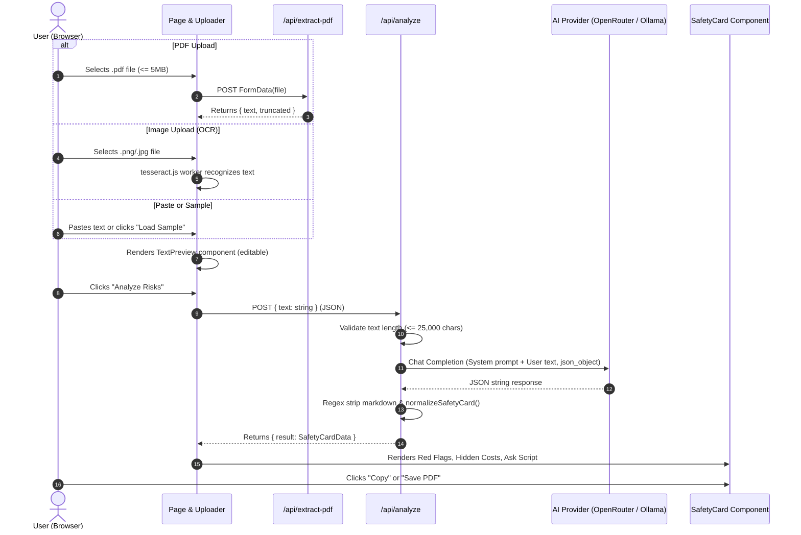
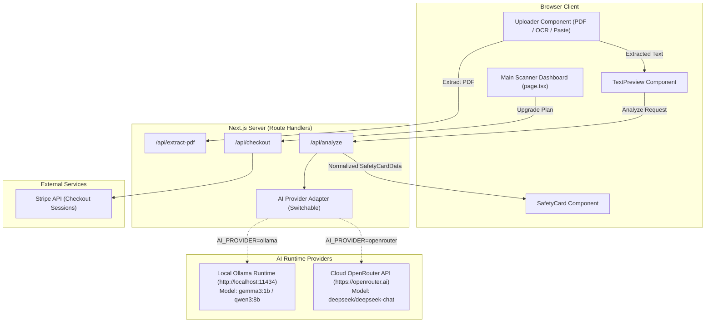

# ARCHITECTURE.md — Fine Prints & Hidden Trap Decoder

## 1. System Overview

**Fine Prints & Hidden Trap Decoder** is a specialized contract risk analysis web application. It ingests complex, legal, or financial text from contracts, leases, terms of service, and agreements via multiple input methods (PDF file upload, image OCR, manual copy-paste, or preloaded sample text). It extracts and prepares the text, dispatches it to a large language model with specialized guardrail prompting, and renders an actionable, structured **"Safety Card"** consisting of:
1. **Red Flag Clauses**: Clauses that strip consumer rights, enforce binding arbitration, or grant unilateral data access.
2. **Hidden Money Costs**: Hidden renewal fees, early termination fees, delay penalties, and clarification notes.
3. **Ask Before Signing Script**: Concise, diplomatic questions the user can copy and paste to negotiate or clarify ambiguous terms.

The application includes a client-side scanning counter (simulated free tier) and a pricing page integrated with Stripe Checkout for subscription upgrades (Plus and Pro tiers).

---

## 2. Verified Technology Stack

| Layer | Technology | Version | Discovery / File Citation |
|---|---|---|---|
| **Runtime Environment** | Node.js | v22.23.3 (Host) / `>=20` | System inspection; `package.json` specifies `"node": ">=20"` types |
| **Framework** | Next.js (App Router) | `16.3.4` | `package.json:14` |
| **Frontend Library** | React & React-DOM | `19.2.8` | `package.json:17-18` |
| **Styling & Design System** | Vanilla CSS Modules | CSS3 Custom Properties | `src/app/globals.css`, `src/app/page.module.css` |
| **Iconography** | Lucide React | `^1.41.0` | `package.json:13` |
| **PDF Extraction** | `pdf-parse` | `^2.4.5` | `package.json:16`, `src/app/api/extract-pdf/route.ts:2` |
| **Image OCR** | `tesseract.js` | `^7.0.0` | `package.json:20`, `src/components/Uploader.tsx:78` |
| **AI Client SDK** | `openai` | `^7.10.0` | `package.json:15`, `src/app/api/analyze/route.ts:2` |
| **Current AI Provider** | OpenRouter (`openrouter.ai`) | API v1 | `src/app/api/analyze/route.ts:68` |
| **Current AI Model** | `deepseek/deepseek-chat` | Hosted via OpenRouter | `src/app/api/analyze/route.ts:94` |
| **Payment SDK** | `stripe` | `^22.6.1` | `package.json:19`, `src/app/api/checkout/route.ts:2` |
| **Unused Payment SDK** | `@stripe/stripe-js` | `^9.15.0` | `package.json:12` (Not imported anywhere in code) |
| **TypeScript** | TypeScript | `^5` | `package.json:28`, `tsconfig.json` |
| **Linter** | ESLint | `^9` | `package.json:26`, `eslint.config.mjs` |

---

## 3. Directory and Module Responsibilities

### Root Configuration
- `next.config.ts`: Enforces HTTP Content Security Policy (CSP), frame options, and permissions policies.
- `tsconfig.json`: Defines TypeScript strictness and module resolution with `@/*` path mapping to `./src/*`.
- `eslint.config.mjs`: Configures Next.js core web vitals and TypeScript lint rules.

### Presentation Layer (`src/app/`, `src/components/`)
- `src/app/layout.tsx`: HTML root shell, metadata definition, and global stylesheet import.
- `src/app/page.tsx`: Single-page orchestrator holding core React state:
  - `extractedText: string`: Active text buffer.
  - `isLoadingFile: boolean`: Status flag during PDF parsing or OCR extraction.
  - `isAnalyzing: boolean`: Status flag while waiting for AI completion.
  - `analysisResult: SafetyCardData | null`: Parsed safety card data object.
  - `scansLeft: number`: Client-side simulated scan limit (initialized to 3).
- `src/components/Uploader.tsx`: Multi-channel ingestion widget.
  - File picker: Supports `.pdf,image/png,image/jpeg,image/jpg` under 5MB.
  - Client OCR: Imports `tesseract.js` dynamically in browser to extract text from images.
  - Direct paste textarea: Validates minimum 20 characters.
  - Sample loader: Injects standard demo terms of service agreement.
- `src/components/TextPreview.tsx`: Edit window allowing users to review and trim text before sending to AI (enforces 25,000 character maximum).
- `src/components/SafetyCard.tsx`: Presentation of categorized analysis results. Provides one-click text copy to clipboard and print-to-PDF via `window.print()`.
- `src/app/pricing/page.tsx`: Marketing and tier selection page (Free $0, Plus $12/mo, Pro $29/mo). Dispatches checkout requests.
- `src/app/success/page.tsx` & `src/app/cancel/page.tsx`: Redirect targets after Stripe Checkout sessions.

### Backend API Layer (`src/app/api/`)
- `src/app/api/analyze/route.ts`: Node.js runtime Route Handler. Validates request length, connects to AI provider via OpenAI SDK, applies system prompt, requests JSON output, cleans JSON, and normalizes output schema.
- `src/app/api/extract-pdf/route.ts`: Node.js runtime Route Handler. Receives multipart `FormData` with a PDF file, parses text using `pdf-parse`, and truncates at 25,000 characters.
- `src/app/api/checkout/route.ts`: Node.js runtime Route Handler. Validates `planId`, initializes Stripe client, and creates a Stripe Checkout session in `subscription` mode.

---

## 4. Main Application Execution Flow



---

## 5. Frontend & Backend Interaction

1. **Client-to-Server Boundaries:**
   - The browser never communicates with external AI services directly.
   - All AI requests flow through `/api/analyze`.
   - All PDF binary processing flows through `/api/extract-pdf`.
   - All Stripe session creations flow through `/api/checkout`.
2. **Data Formats:**
   - Document upload: `multipart/form-data` containing `file: File`.
   - Analysis: `application/json` containing `{ text: string }`.
   - Checkout: `application/json` containing `{ planId: "price_plus" | "price_pro" }`.
3. **Response Formats:**
   - Analysis Success: `{ result: { redFlags: [...], hiddenCosts: [...], askScript: [...] } }`.
   - Extraction Success: `{ text: string, truncated: boolean }`.
   - Checkout Success: `{ url: string }`.
   - Errors: Standardized JSON `{ error: string }` with corresponding HTTP status codes.

---

## 6. AI Request Lifecycle & Dual-Provider Integration

### Provider Configuration (Implemented)
The provider is selected at runtime via `process.env.AI_PROVIDER` (`'ollama'` or `'openrouter'`, default: `'openrouter'`). Both providers use the same `openai` npm SDK with different base URLs.

| Setting | Ollama (Local) | OpenRouter (Cloud) |
|---|---|---|
| **Base URL** | `${OLLAMA_BASE_URL}/v1` (default `http://localhost:11434/v1`) | `https://openrouter.ai/api/v1` |
| **API Key** | `'ollama'` (dummy, no auth required) | `process.env.OPENROUTER_API_KEY` |
| **Model** | `process.env.OLLAMA_MODEL` (default `gemma3:1b`) | `deepseek/deepseek-chat` |
| **Timeout** | 60 seconds (`AbortSignal.timeout`) | 60 seconds (`AbortSignal.timeout`) |
| **Sampling** | `temperature: 0.1` | `temperature: 0.1` |
| **Format** | `response_format: { type: 'json_object' }` | `response_format: { type: 'json_object' }` |
| **Streaming** | Disabled | Disabled |

### Request Lifecycle Details
1. **Initiation:** Invoked from `src/app/page.tsx:handleAnalyze()` when user clicks "Analyze Risks".
2. **Payload Structure:**
   ```json
   {
     "model": "deepseek/deepseek-chat",
     "messages": [
       { "role": "system", "content": "You are Fine Prints & Hidden Trap Decoder..." },
       { "role": "user", "content": "Analyze the following text and extract the safety card information in JSON format:\n\n<contract_text>" }
     ],
     "temperature": 0.1,
     "response_format": { "type": "json_object" }
   }
   ```
3. **Response Processing (`src/app/api/analyze/route.ts:106-123`):**
   - The raw string is extracted from `completion.choices[0].message.content`.
   - A fallback parser checks for markdown code fencing ```` ```json ... ``` ```` or locates outermost curly braces `{ ... }`.
   - `JSON.parse()` converts the string to an object.
   - `normalizeSafetyCard()` sanitizes fields:
     - `redFlags`: array capped at 10 items, fields `clause` (max 500 chars), `explanation` (max 1000 chars), `riskLevel` (`'Low'` | `'Medium'` | `'High'`).
     - `hiddenCosts`: array capped at 10 items, fields `fee` (max 300 chars), `whenApplies` (max 700 chars), `clarify` (max 700 chars).
     - `askScript`: array capped at 3 strings (max 500 chars each).
4. **State Updates & Persistence:**
   - The returned object is set in `Home` component state (`setAnalysisResult(data.result)`).
   - No database persistence: All data resides in browser memory and is lost upon page refresh.

---

## 7. Database, Storage & External Services

- **Database:** None. The application is completely stateless.
- **Session / Auth:** None. User accounts do not exist in the codebase.
- **Stripe Service:**
  - Configured in `src/app/api/checkout/route.ts` via secret key `STRIPE_SECRET_KEY`.
  - API Version: `2026-08-26.dahlia`.
  - Creates checkout sessions for recurring subscriptions:
    - `price_plus`: $12.00 / month
    - `price_pro`: $29.00 / month
  - Success URL: `${origin}/success?session_id={CHECKOUT_SESSION_ID}`
  - Cancel URL: `${origin}/cancel`
  - Integration Identifier: `fineprints_checkout_qjvmtxla`
  - **Fulfillment Status:** There is NO webhook route (`/api/webhooks/stripe` or similar). Returning to `/success` displays a static confirmation message, but does not persist subscription status.

---

## 8. Environment Configuration & Trust Boundaries

### Environment Variables
| Variable | Scope | Required / Optional | Verified Purpose |
|---|---|---|---|
| `APP_URL` | Server | Optional in dev, Required in prod | Resolves origin for Stripe success/cancel redirect URLs |
| `NEXT_PUBLIC_APP_URL` | Client / Server | Optional fallback | Secondary origin fallback for `APP_URL` |
| `OPENROUTER_API_KEY` | Server | Required for current AI | Bearer token for OpenRouter completions API |
| `STRIPE_SECRET_KEY` | Server | Required for Stripe checkout | Secret key used by Stripe Node SDK |
| `NEXT_PUBLIC_STRIPE_PUBLISHABLE_KEY` | Client | Optional (Documented in README) | Declared in README for frontend Stripe elements; currently unused |

### Trust Boundaries
1. **Secrets Isolation:** No secret environment variables are prefixed with `NEXT_PUBLIC_`. All secret consumption is restricted to Route Handlers (`runtime = 'nodejs'`).
2. **CSP Configuration (`next.config.ts`):**
   - Directs `connect-src 'self' https://openrouter.ai https://*.stripe.com`.
   - Directs `frame-src https://*.stripe.com https://*.link.com`.
   - Restricts script execution to `'self' 'unsafe-inline' 'unsafe-eval' blob:`.

---

## 9. Current Limitations & Technical Debt

1. **Double Root Directory Structure:** The workspace has an outer directory `Fine-Prints-Hidden-Trap-Decoder-main` containing an identical nested folder `Fine-Prints-Hidden-Trap-Decoder-main` with the actual project files.
2. **Port 3000 Collision Risk:** An independent test server running from `C:\Users\Hp\local-ai-demo\` is currently occupying port 3000 on the host machine.
3. **No Automated Tests:** The repository contains no unit tests (`*.test.ts`), integration tests, or end-to-end tests.
4. **No Persistence or User Accounts:** The scan limit counter (`scansLeft = 3`) is client-side React state. Refreshing the browser resets the counter. Stripe checkouts do not grant verified subscriptions.
5. **Unused Dependencies:** `@stripe/stripe-js` is listed in `package.json` but never imported.
6. **Hardcoded Model Name:** The AI model `'deepseek/deepseek-chat'` is hardcoded in `src/app/api/analyze/route.ts` rather than configurable via environment variables.

---

## 10. Proposed Target Architecture Using Local Ollama



### Architectural Design for Ollama Migration

1. **Provider Adapter Pattern:**
   Instead of hardcoding Ollama or OpenRouter, introduce a clean provider adapter in `/api/analyze` or a helper module `src/lib/ai.ts`.
   - Selection driven by `process.env.AI_PROVIDER || 'openrouter'`.
   - When set to `'ollama'`:
     - Target endpoint: `process.env.OLLAMA_BASE_URL || 'http://localhost:11434'`
     - Model: `process.env.OLLAMA_MODEL || 'gemma3:1b'`
     - Can use either Ollama's native `/api/chat` endpoint OR Ollama's OpenAI-compatible endpoint `http://localhost:11434/v1`.
2. **Defensive Schema Parsing for Small Local Models:**
   - Empirical testing revealed that `gemma3:1b` (1B parameter model) can output string arrays for `redFlags` rather than arrays of objects with `clause`, `explanation`, and `riskLevel`.
   - The normalization logic in `normalizeSafetyCard` must be enhanced to accept both objects AND raw strings:
     ```ts
     // If item is a string, synthesize a valid redFlag object
     if (typeof item === 'string') {
       return {
         clause: item.slice(0, 500),
         explanation: item.slice(0, 1000),
         riskLevel: 'Medium' as RiskLevel,
       };
     }
     ```
3. **Structured Output (JSON Schema):**
   - Ollama v0.5+ supports JSON schema via `format: { type: "object", properties: { ... } }`.
   - Providing explicit JSON schema constraints to Ollama guarantees syntactically valid JSON output from local models.
4. **Latency & Timeout Handling:**
   - Local models running on consumer hardware (especially on CPU or shared GPU) may experience inference latencies between 5s and 60s.
   - Route Handlers must configure a sufficient timeout (e.g. `AbortSignal.timeout(60000)`).

---

## 11. Migration Risks & Compatibility Requirements

| Risk Factor | Cloud OpenRouter (`deepseek/deepseek-chat`) | Local Ollama (`gemma3:1b`) | Mitigation Strategy |
|---|---|---|---|
| **Parameter Scale & Reasoning** | ~671B MoE parameters. Deep legal reasoning, subtle clause detection. | ~1B dense parameters. Basic keyword detection, simple summaries. | Acknowledge capability downgrade; use `qwen3:8b` or `llama3.2:3b` if hardware allows. |
| **JSON Schema Adherence** | High adherence to nested JSON object structure. | Tends to collapse nested objects into string arrays or omit fields. | Update `normalizeSafetyCard` with polymorphic fallback parsing for strings and missing fields. |
| **Inference Latency** | Typically 2–5 seconds via cloud API. | 3–10s on GPU; 30–60s+ on CPU. | Display clear loading indicators ("Analyzing contract with local AI..."); implement 60s timeouts. |
| **Context Window Size** | Up to 64k+ tokens. | 32,768 tokens (Gemma 3). | Keep 25,000 character limit (~5k tokens), which fits comfortably within Gemma 3's context window. |
| **Service Availability** | Requires internet and valid credit/API key. | Offline, zero-cost, private, but depends on local Ollama daemon running. | Implement graceful error detection with instructions if Ollama is not running on port 11434. |
| **Security & Privacy** | Document text is sent to third-party cloud. | 100% on-device processing. No document data leaves the machine. | Highlight offline privacy benefits in UI. |
